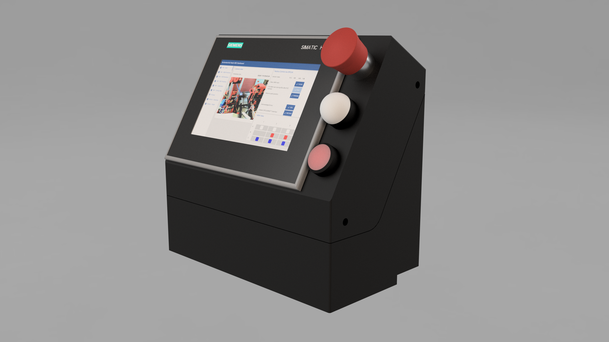
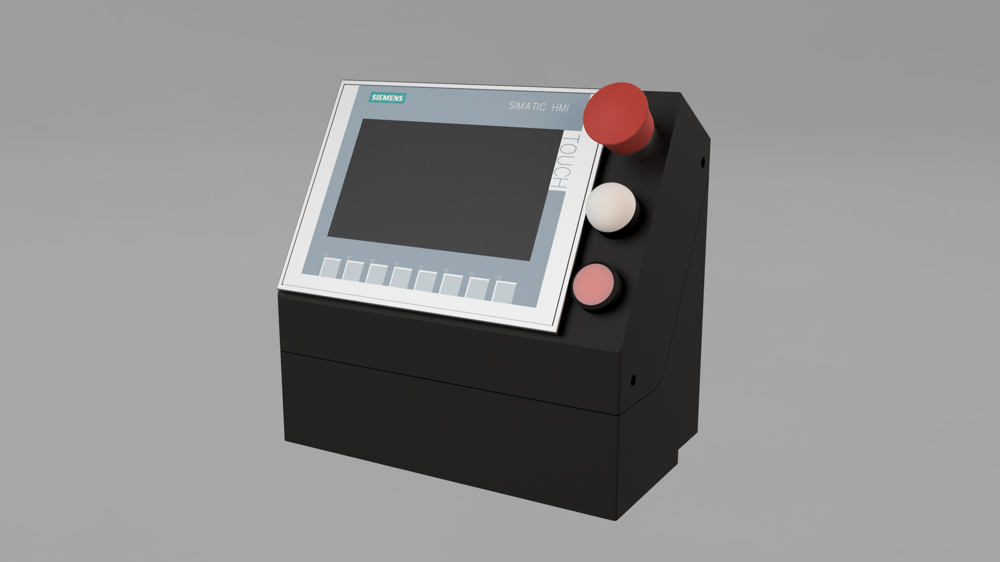

# FT-Mount v15 – 3D Printing Notes

**Author:** Martin McCorkle ([@X1-McFly](https://github.com/X1-McFly))

> **Compatibility:** Fits the Siemens SIMATIC **KTP700 Basic** and **TP700 Comfort** 7" HMI panels.

## Parts

| File | Part | Size X × Y × Z (mm) |
|---|---|---|
| `ft-mountv15_part1.stl` | Upper housing (HMI + IO) | 255.6 × 138.3 × 180.0 |
| `ft-mountv15_part2.stl` | Lower housing / base | 255.6 × 138.3 × 217.3 |
| `ft-mountv15_part3.stl` | Back plate | 251.0 × 4.1 × 173.4 |

## Printer Requirements

- **Build volume:** Greater than or equal to **256 × 256 × 256 mm**. Every part 1 & 2 are ~256 mm long on the longest side, so leave some margin.
- **Heated/enclosed chamber recommended.** The large, flat parts warp easily without one.
- **Material & Bed Type:** PLA with a smooth build plate is acceptable for indoor use only. Otherwise, PETG or ABS is recommended.
- **Suggested settings:** 0.2 mm layers, 3–4 walls, 15–25 % infill, brim on. Supports only where your slicer flags overhangs.

## Hardware

| Qty | Item | Use |
|---|---|---|
| 4 | M6 screw + nut/washer | Joins Part 1 to Part 2 (Ø7.0 mm through-holes) |
| 4 | M2.5 screw | Fastens the back plate (Part 3) |
| 4 | M2.5 heat-set threaded insert | Pressed into the housing for the back plate screws |

## Assembly

1. Bolt Part 1 onto Part 2 with the four M6 screws.
2. Mount the buttons/IO.
3. (Optional) Press the M2.5 heat-set inserts in with a soldering iron (~200–230 °C for PLA/PETG).
4. (Optional) Attach the back plate with the four M2.5 screws.
5. Insert HMI into part 1
